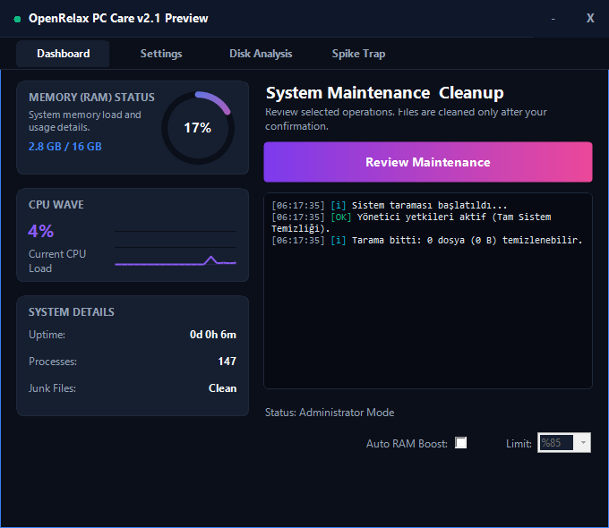
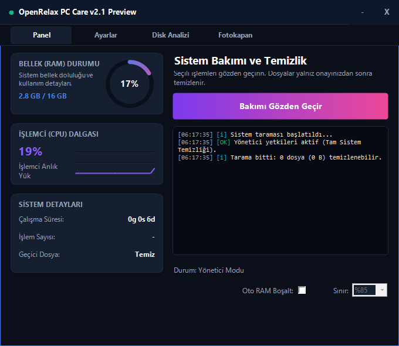
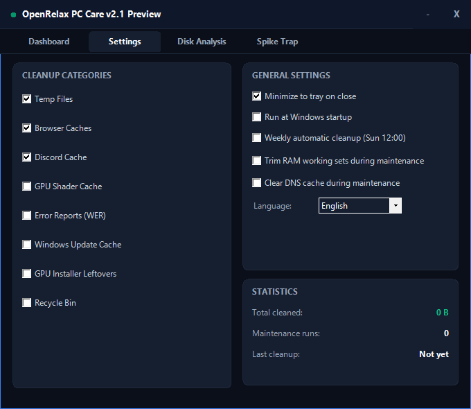
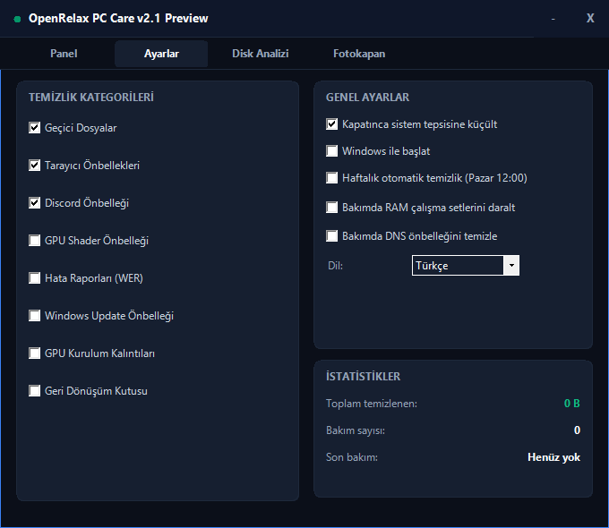
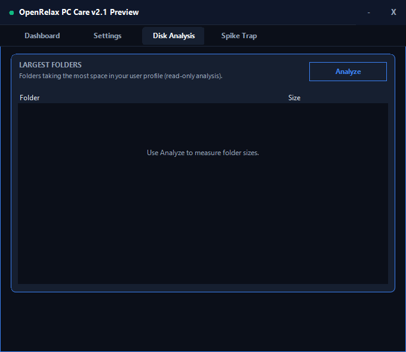
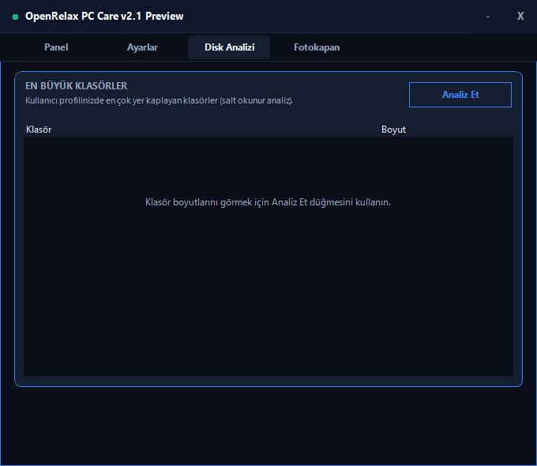
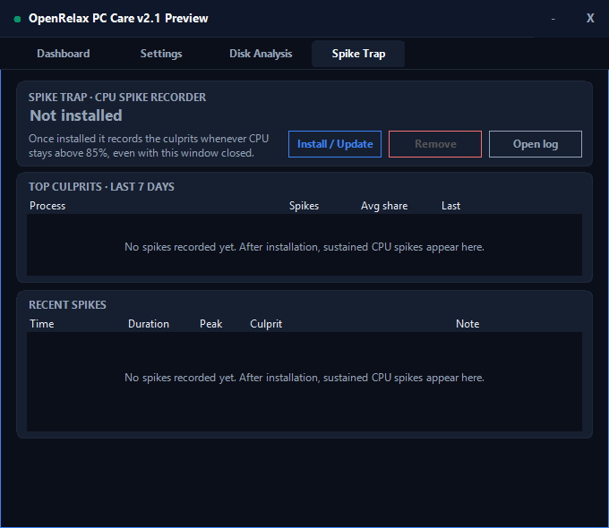
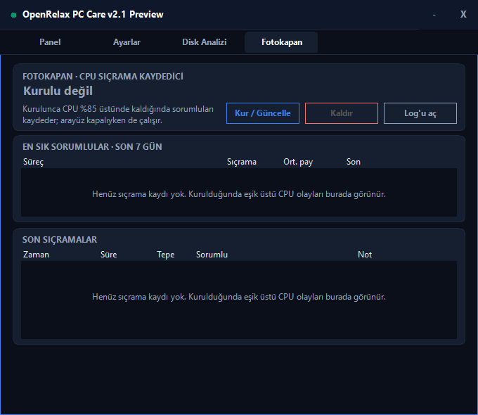

# Verified interface captures

These eight 680×590 screenshots are real OpenRelax 2.1 Preview WinForms captures
from the passing [GitHub Actions run 38117327204](https://github.com/mehmeterendereli/openrelax/actions/runs/38117327204)
at commit `994cad0ea63db22b45d13c66b6bdae036331fc40`. The workflow exercised the native UI in both supported
languages before publishing its evidence artifact. They are not design mock-ups
or proof of the remaining release gates listed in the root [README](../../README.md).

| Page | English | Türkçe |
| --- | --- | --- |
| Dashboard / Panel |  |  |
| Settings / Ayarlar |  |  |
| Disk Analysis / Disk Analizi |  |  |
| Spike Trap / Fotokapan |  |  |

Capture checks and source packaging passed in that run. GitHub-hosted evidence is
bounded: it does not certify physical keyboard use, Narrator, monitor-DPI
transitions, RDP, signing, a stable release or an LTS support period.
